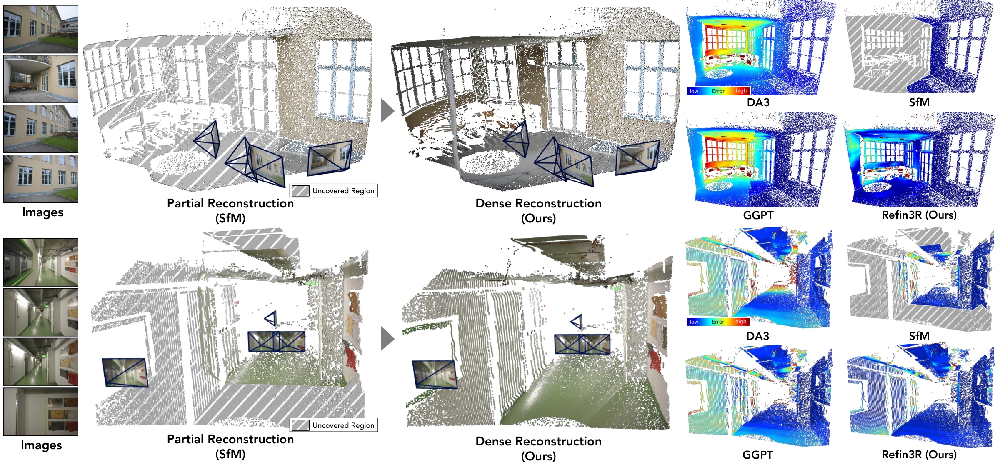
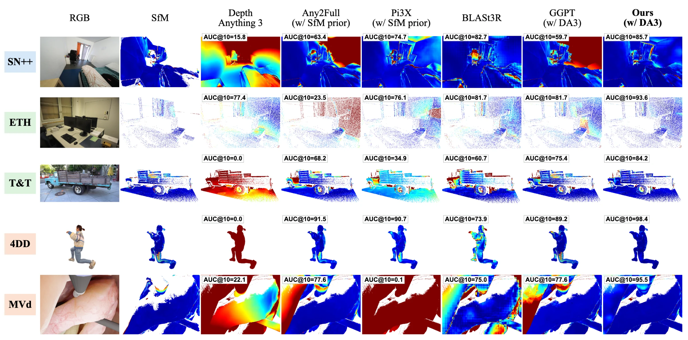

<h1 align="center">Refin3R: Geometry-Guided Refinement for<br>Feed-Forward 3D Reconstruction</h1>

<p align="center">
  <a href="https://icetea-cv.github.io/">Jongmin&nbsp;Lee</a> ·
  <a href="https://kjae0.github.io/">Jaeyeong&nbsp;Kim</a> ·
  <a href="https://cvlab.kaist.ac.kr/members">Seungryong&nbsp;Kim</a><sup>†</sup>
</p>

<p align="center">KAIST&nbsp;AI<br><sub>† Corresponding author</sub></p>

<p align="center">
  <a href="https://cvlab-kaist.github.io/Refin3R"></a>
</p>

> **TL;DR** &nbsp; *Refine feed-forward point maps (e.g. DA3) with SfM points: **dense and accurate**, even where SfM has no coverage.*

<p align="center">
  
</p>

<p align="center">
  <a href="#overview">Overview</a> · <a href="#results">Results</a> · <a href="#todo">TODO</a> · <a href="#getting-started">Setup</a> · <a href="#inference">Inference</a> · <a href="#training">Training</a> · <a href="#citation">Citation</a>
</p>

<a id="overview"></a>

## ✨ Overview

Point maps from feed-forward models (e.g. [Depth Anything 3](https://github.com/ByteDance-Seed/Depth-Anything-3)) are often inconsistent across views and lack fine-grained precision. **Refin3R** refines these point maps with SfM points, as per-view depth on the image grid.

- **Dense & Accurate:** Partial SfM guidance is enough to refine the whole image accurately.
- **Fast:** 0.86 s for 16 views on an RTX A6000, 15× faster than GGPT, which uses the same SfM front-end.

<a id="results"></a>

## 📊 Results

Refin3R achieves the best point map accuracy on ScanNet++, ETH3D, and Tanks&Temples, and on the out-of-domain 4D-DRESS and MV-dVRK benchmarks.

<p align="center">
  
</p>

<details>
<summary><b>Point map accuracy, 8 input views (AUC@1 cm / AUC@5 cm, % ↑)</b></summary>

<br>

| Method | ScanNet++ | ETH3D | Tanks&Temples |
|:--|:-:|:-:|:-:|
| *Feed-forward* | | | |
| Depth Anything 3 | 0.9 / 7.1 | 8.0 / 29.6 | 0.7 / 7.1 |
| Pi3X (RGB only) | 15.3 / 53.9 | 6.1 / 28.8 | 3.9 / 23.5 |
| VGGT-Ω | 1.3 / 13.5 | 3.1 / 22.2 | 1.5 / 14.6 |
| *Geometry-conditioned feed-forward* | | | |
| MapAnything | 13.3 / 43.8 | 6.3 / 25.0 | 2.5 / 15.1 |
| Pi3X | 18.2 / 55.5 | 12.9 / 40.0 | 8.1 / 34.9 |
| *Depth completion* | | | |
| Any2Full | 28.6 / 59.6 | 28.5 / 55.4 | 13.1 / 42.1 |
| Murre | 21.3 / 53.1 | 13.6 / 35.4 | 6.6 / 25.7 |
| *Feed-forward w/ multi-view geometry* | | | |
| MASt3R-SfM | 15.6 / 41.0 | 17.5 / 37.7 | 18.2 / 41.6 |
| BLASt3R | 34.5 / 64.7 | 13.6 / 34.9 | 5.2 / 22.7 |
| GGPT (w/ DA3) | 27.4 / 56.9 | 28.4 / 58.7 | 16.0 / 46.1 |
| GGPT (w/ Pi3X) | 29.5 / 62.8 | 32.7 / 62.0 | 19.1 / 49.7 |
| **Refin3R (w/ DA3)** | <ins>37.5</ins> / <ins>68.8</ins> | **46.4** / <ins>69.9</ins> | <ins>20.5</ins> / **52.1** |
| **Refin3R (w/ Pi3X)** | **39.6** / **71.4** | <ins>46.3</ins> / **70.2** | **21.5** / <ins>52.0</ins> |

Best in **bold**, second-best <ins>underlined</ins>. All methods that take geometric priors receive the same SfM output. See the paper for the 4- and 16-view splits and the out-of-domain benchmarks.

</details>

<a id="todo"></a>

## 📌 TODO

- [ ] Release the paper and project page.
- [ ] Release inference code and a runnable multi-view example.
- [ ] Release evaluation code.
- [ ] Release training code with configurations.

<a id="getting-started"></a>

## 🚀 Getting started

> **Release status:** This repository currently provides documentation only. Code and pretrained checkpoints are not yet available here.

```bash
git clone https://github.com/cvlab-kaist/Refin3R.git
cd Refin3R
```

<a id="inference"></a>

## Inference

🚧 To be updated

<a id="training"></a>

## Training

🚧 To be updated

<a id="citation"></a>

## Citation

```bibtex
@misc{lee2026refin3rgeometryguidedrefinementfeedforward,
      title={Refin3R: Geometry-Guided Refinement for Feed-Forward 3D Reconstruction},
      author={Jongmin Lee and Jaeyeong Kim and Seungryong Kim},
      year={2026},
      eprint={2611.23051},
      archivePrefix={arXiv},
      primaryClass={cs.CV},
      url={https://arxiv.org/abs/2611.23051},
}
```
